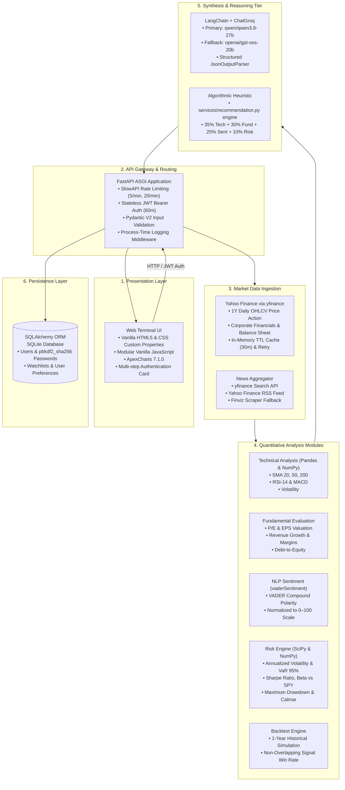
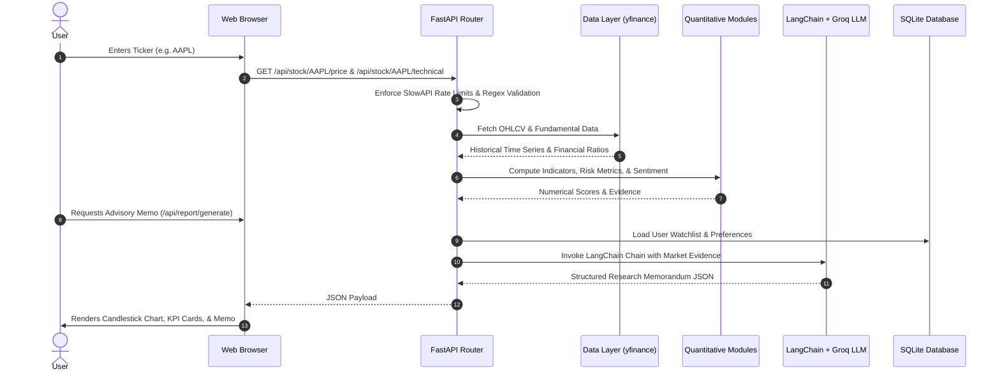

# TradeIQ (StockSense AI) — Technical Overview & Architectural Specification

> **Project Document**: Technical specification and architecture overview for TradeIQ (StockSense AI), a stock research and analysis application developed as a portfolio project.

---

## 1. Project Overview

**TradeIQ (StockSense AI)** is a full-stack stock research and equity analysis web application developed as an engineering portfolio project. The system aggregates real-time and historical market data, runs deterministic technical and fundamental calculations, computes statistical risk metrics, simulates historical signal performance, and uses large language models (LLMs) via LangChain and Groq to synthesize structured research memorandums.

The project combines:
* **Technical Indicators**: Moving averages (SMA 20, 50, 200), RSI-14, MACD (12, 26, 9), and annualized price volatility.
* **Fundamental Valuation**: Trailing/Forward P/E, Diluted EPS, YoY Revenue Growth, Profit Margins, and Debt-to-Equity ratios via `yfinance` with an in-memory TTL cache and retry mechanism.
* **Financial NLP Sentiment**: News headline retrieval from Yahoo Finance search, RSS feeds, and Finviz with rule-based VADER sentiment polarity scoring.
* **Statistical Risk Modeling**: Annualized Volatility, historical Value at Risk (VaR 95%), Beta vs S&P 500 (SPY benchmark), Sharpe Ratio, Maximum Drawdown, and Calmar Ratio.
* **Rule-Based Backtesting**: A 1-year historical signal simulator evaluating trade accuracy and win rates on technical cross triggers.
* **LLM Synthesis**: LangChain-orchestrated prompt synthesis querying Groq Cloud (`qwen/qwen3.8-27b` with `openai/gpt-oss-20b` fallback).

---

## 2. System Architecture

The application is structured into decoupled layers, separating presentation, API routing, quantitative feature engineering, and LLM synthesis:

---

## 3. End-to-End Processing Flow

---

## 4. Comprehensive Technology Stack Taxonomy

All dependency versions below match the project's [requirements.txt](requirements.txt):

| Layer | Component | Version | Role in Architecture |
|---|---|---|---|
| **API Framework** | FastAPI | `0.135.2` | High-performance ASGI framework with automatic OpenAPI documentation. |
| **ASGI Server** | Uvicorn | `0.42.0` | Production ASGI web server running with `--proxy-headers` and `--forwarded-allow-ips`. |
| **Market Data** | yfinance | `1.2.0` | Downloads historical OHLCV pricing, corporate balance sheet ratios, and news. |
| **Data Manipulation** | Pandas | `3.0.1` | Time-series manipulation, rolling window statistics, and returns calculations. |
| **Numeric Operations** | NumPy | `2.2.6` | Vectorized log returns, percentiles, standard deviation, and covariance. |
| **Statistical Modeling** | SciPy | `1.17.1` | Linear regression for Beta calculation against SPY and normal distribution calculations. |
| **Database & ORM** | SQLAlchemy | `2.0.48` | Relational ORM managing user models, watchlists, and investment preferences. |
| **Validation & Schema** | Pydantic | `2.12.5` | Data validation, response models, and strict configuration constraints. |
| **Settings Management** | pydantic-settings | `2.14.0` | Environment configuration with startup validation (e.g., SECRET_KEY enforcement). |
| **API Rate Limiting** | SlowAPI | `0.1.10` | IP-based token bucket rate limiter (5 req/min on auth, 20 req/min on data routes). |
| **Sentiment Analysis** | vaderSentiment | `3.3.2` | Rule-based lexical polarity scoring for financial news headlines. |
| **HTML / News Parsing** | BeautifulSoup4 | `4.14.3` | Parsing headlines from web feeds and secondary news sources. |
| **HTTP Client** | Requests | `2.32.5` | Synchronous HTTP calls for fallback news RSS feeds. |
| **Password Security** | Passlib | `1.7.4` | Password hashing using `pbkdf2_sha256`. |
| **Session Security** | Python-Jose | `3.5.0` | Stateless JWT access token generation and cryptographic decoding. |
| **Form Data Handling** | Python-Multipart | `0.0.27` | OAuth2 password request form parsing for login endpoints. |
| **Caching** | Cachetools | `7.2.0` | Thread-safe in-memory caching for market time-series and fundamentals. |
| **LLM Client** | Groq | `0.37.1` | Official Python client for Groq Cloud API inference. |
| **LLM Orchestration** | LangChain Core & Groq | `1.2.15` / `1.1.2` | Prompt templating, structured `JsonOutputParser`, and LLM chain execution. |
| **Environment Loading** | Python-Dotenv | `1.2.2` | Loads local environment variables from `.env`. |
| **Frontend UI** | Vanilla HTML5 / CSS / JS | Native ES6 | Custom property styling, dark/light theme, and no frontend build dependencies. |
| **Data Visualization** | ApexCharts | `7.1.0` | Interactive candlestick, volume, and drawdown chart rendering in the browser. |
| **Containerization** | Docker | Single-Stage | `python:3.11-slim` image with non-root user execution on port 10000. |
| **Testing** | Pytest & Pytest-Cov | `9.1.1` / `7.1.0` | 49 passing automated unit, API, and validation tests. |
| **Code Quality** | Ruff | `0.1.0+` | Fast Python linter and code formatter. |

---

## 5. Architectural Implementation Details

### Scoring Mechanisms
1. **Advisory Memorandum Synthesis (`services/ai_report.py`)**:
   - Gathers historical price technicals, fundamental metrics, news sentiment, and backtest accuracy for candidate stocks.
   - Computes deterministic score constraints based on user preferences (e.g. Technical 55/15/30, Fundamental 20/55/25, Sentiment 25/20/55; Conservative vs. Aggressive thresholds).
   - Injects the metrics into a LangChain prompt template and queries Groq (`temperature=0.0`) to produce an executive research memorandum with structured JSON outputs.

2. **Standalone Algorithmic Recommendation Engine (`services/recommendation.py`)**:
   - Implements a pure Python rule-based heuristic weighting factors:
     $$\text{Score} = (0.35 \times S_{\text{Technical}}) + (0.30 \times S_{\text{Fundamental}}) + (0.25 \times S_{\text{Sentiment}}) + \text{Risk Adjustment}$$
   - Evaluates oversold/overbought conditions, moving average crosses, P/E multiples, and sentiment polarity.

### Risk Modeling
- **Annualized Volatility**: Daily log return standard deviation scaled by $\sqrt{252}$.
- **Value at Risk (VaR 95%)**: Empirical 5th percentile of daily historical log returns.
- **Beta vs S&P 500**: Ordinary Least Squares (OLS) slope of stock returns against SPY returns.
- **Sharpe Ratio**: Ratio of annualized excess return (over assumed 5% risk-free rate) to annualized volatility.
- **Maximum Drawdown**: Largest observed peak-to-trough decline over the 1-year historical window.

### Authentication & Session Security
- Passwords are encrypted using `pbkdf2_sha256` via `passlib`.
- Authentication uses stateless JWT tokens (`HS256` algorithm, 60-minute expiration).
- All password inputs in the UI are wrapped in HTML `<form>` tags with corresponding username inputs (`autocomplete="username"` and `autocomplete="current-password"`) to ensure compatibility with modern browser password managers.

---

## 6. Known Limitations

- **yfinance Upstream Rate Limits**: Market pricing and fundamental data depend on the public Yahoo Finance service via `yfinance`. High request volumes or IP rate limits by the provider can occasionally cause fundamental metrics to be missing or delayed.
- **Free-Tier Host Cold Starts**: When deployed on free-tier application hosting (e.g. Render free tier), the server spins down after periods of inactivity, incurring a 50+ second delay on cold-start requests.
- **LLM Output Variability**: While statistical indicators are purely deterministic, language model outputs can vary across executions depending on model availability and provider inference behavior.
- **Local SQLite Concurrency**: The default database configuration uses SQLite. While suitable for single-process setups and development, concurrent write operations in multi-worker environments should use PostgreSQL.

---

## 7. Quality Assurance & Verification

- **Automated Tests**: 49 passing tests in `tests/`:
  - `test_ai_report.py`: Report parsing, profile weights, missing fundamentals handling, and mocked LLM prompt assertion.
  - `test_auth_api.py`: User registration, login, JWT token auth, 401 unauthorized access, watchlist isolation, password changes, input max-length bounds, and preferences validation.
  - `test_fundamental.py`: Fundamental metrics calculation, edge cases, and in-memory TTL caching.
  - `test_quant_backtest.py`: Historical trade simulator accuracy and distinct signal counting.
  - `test_risk_assessment.py`: Volatility, VaR 95%, Sharpe, Beta, and drawdown calculations.
  - `test_sentiment.py`: VADER polarity scoring and headline parsing fallbacks.
  - `test_technical.py`: Moving averages, RSI, and MACD calculation correctness.
  - `test_validation.py`: Regex ticker parameter validation and schema constraints.
- **Code Standards**: 100% compliant with `ruff check .` and formatted with `ruff format .`.

---

## 8. Disclaimer

**NOT FINANCIAL ADVICE**: TradeIQ (StockSense AI) is strictly an educational software project built for demonstration and research purposes. None of the indicators, ratings, memorandums, or backtests constitute investment, financial, or trading advice. Past performance is no guarantee of future results. Always perform independent research and consult a licensed financial advisor before making any financial decisions.
